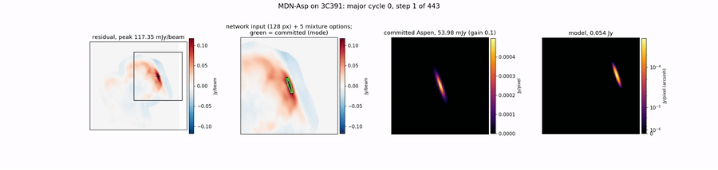
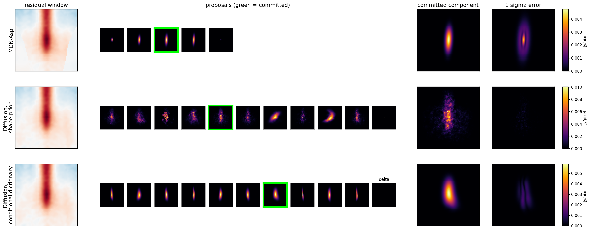
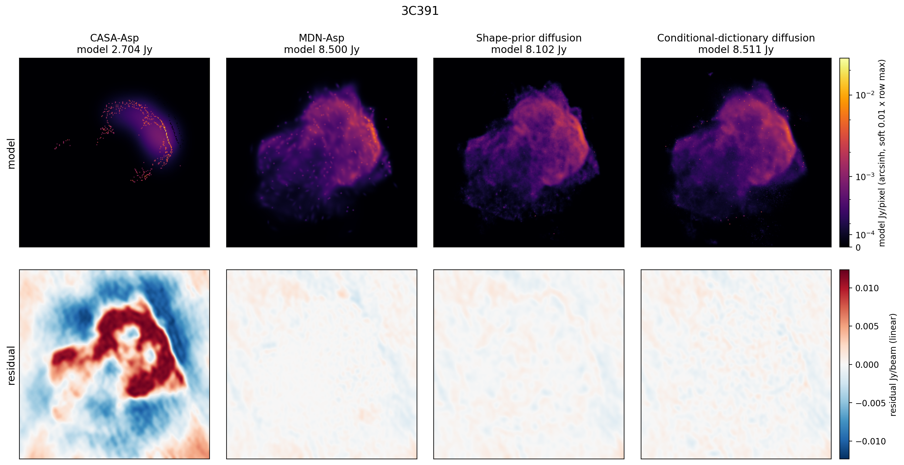
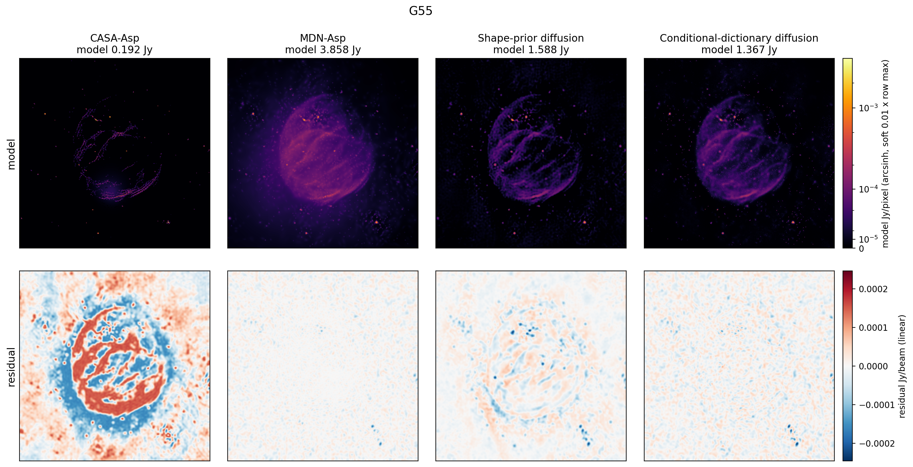
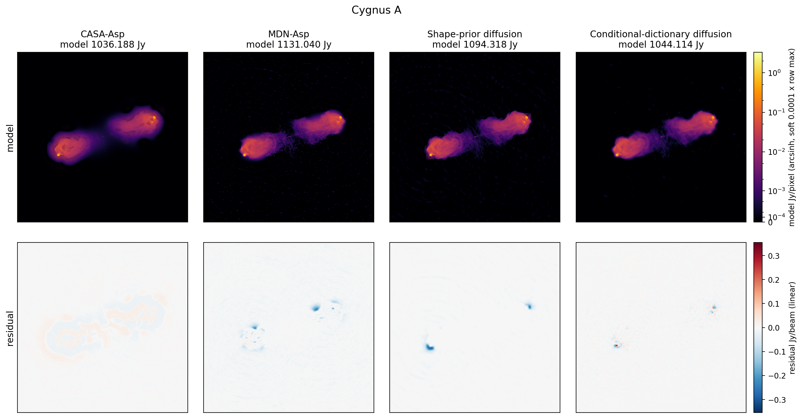
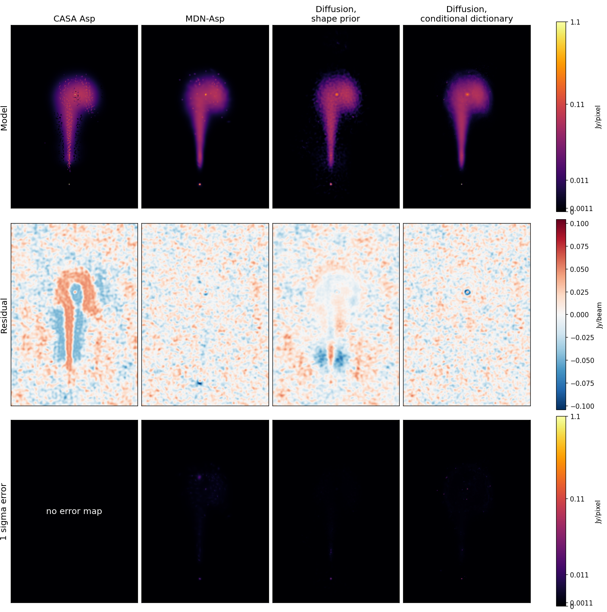

# MDN-Asp

MDN-Asp is a learned Asp minor cycle for CLEAN. CLEAN's major and minor cycles stay, with the exact measurement operator (CASA tclean with niter=0 does the major cycle). At each residual peak a network trained on simulations proposes the component under the peak, and the data decide through the exact likelihood. Three proposers ship in this repository: MDN-Asp (a mixture density network over one Asp component), shape-prior diffusion, and conditional-dictionary diffusion.



MDN-Asp on 3C391. Each frame is one committed component, followed by the major cycles.

## How the loop works



One step of each proposer on a simulated jet at the same pixel. Left to right are the residual window divided by its peak, the proposals with the committed one in green, the committed component, and the 1 sigma error this step adds to the error map.

## Install

The environment is managed with pixi (linux-64 only). There are two environments, `default` (CPU torch) and `gpu` (CUDA). casatools and casatasks come from PyPI inside the pixi environment.

```bash
pixi run test
```

Weights are on Hugging Face.

```bash
hf download skunkworks-ra/mdn-asp --local-dir models/mdn-asp
```

| HF folder | Model | Used for |
|---|---|---|
| (root) | MDN-Asp, points at 0.5 px | 3C391, G55.7+3.4, simulated jet, point-source field |
| `mdn_asp_train` | MDN-Asp, points at 0.1 px | known-flux simulation, early 3C391, G55.7+3.4 and Cygnus A runs |
| `mdn_asp_train256` | MDN-Asp, 256 px cutout | Cygnus A |
| `diffusion_B2` | shape-prior diffusion, step 40,000 | 3C391, G55.7+3.4, Cygnus A, simulated jet |
| `diffusion_A3` | conditional-dictionary diffusion, best at step 46,000 | 3C391, G55.7+3.4, Cygnus A, simulated jet |

Each HF folder was made with `scripts/convert_checkpoint_to_hf.py` and holds the same weights as its source `.pt`.

## Examples

Every example runs `scripts/run_imaging.py` on a Measurement Set. Paths are placeholders, so change `--vis` to where your data live. The commands below are the ones used for the figures. Each figure has the CASA Asp column on the left. The CASA call for it is shown too.

### 3C391

3C391 supernova remnant. The data and the imaging set-up come from the CASA Guide [VLA Continuum Tutorial 3C391](https://casaguides.nrao.edu/index.php/VLA_Continuum_Tutorial_3C391). The Measurement Set is `3c391_ctm_mosaic_10s_spw0.ms`.

The mask is the CASA Asp clean mask grown by 2 beams. Any CASA mask image works, or drop `--mask`.

<details><summary>Commands</summary>

MDN-Asp

```bash
pixi run -e gpu python scripts/run_imaging.py \
    --vis 3c391_ctm_mosaic_10s_spw0.ms \
    --imagename 3c391_uvmosaic_asp \
    --ckpt models/mdn-asp \
    --out_dir runs/3c391_mdn_asp \
    --imsize 480 \
    --field '3C391*' \
    --mask 3c391_mask.mask \
    --no_psf_floor \
    --global_sigma \
    --max_major 10 \
    --max_components 5000 \
    --refit_exact \
    --major_before_refit \
    --refit_all \
    --error_map \
    --sigma_min_px 0.5 \
    --sigma_max_px 96.0 \
    --global_threshold 0.001 \
    --n_posterior_samples 200 \
    --pblimit -0.05 \
    --device cuda:0
```

Shape-prior diffusion

```bash
pixi run -e gpu python -u scripts/run_imaging.py \
    --vis 3c391_ctm_mosaic_10s_spw0.ms \
    --imagename 3c391 \
    --out_dir runs/3c391_diffusion_B2 \
    --imsize 480 \
    --cell 2.5arcsec \
    --field '3C391*' \
    --gridder mosaic \
    --wprojplanes -1 \
    --specmode mfs \
    --robust 0.5 \
    --mask 3c391_mask.mask \
    --mask_radius_px 200 \
    --n_sigma 3.0 \
    --no_psf_floor \
    --loop_gain 0.1 \
    --max_major 10 \
    --max_components 5000 \
    --refit_gain 0.5 \
    --config_idx 3 \
    --divergence_tol 0.2 \
    --global_threshold 0.001 \
    --pblimit -0.05 \
    --refit_exact \
    --major_before_refit \
    --diffusion_ckpt models/mdn-asp/diffusion_B2 \
    --diff_mp \
    --diff_n_draws 10 \
    --diff_seed 0 \
    --device cuda:0 \
    --diff_rebuild_drop 0.2 \
    --refit_noise_lam 1 \
    --fit_unmasked \
    --diff_unmask_output \
    --diff_taper
```

Conditional-dictionary diffusion

```bash
pixi run -e gpu python -u scripts/run_imaging.py \
    --vis 3c391_ctm_mosaic_10s_spw0.ms \
    --imagename 3c391 \
    --out_dir runs/3c391_diffusion_A3 \
    --imsize 480 \
    --cell 2.5arcsec \
    --field '3C391*' \
    --gridder mosaic \
    --wprojplanes -1 \
    --specmode mfs \
    --robust 0.5 \
    --mask 3c391_mask.mask \
    --mask_radius_px 200 \
    --n_sigma 3.0 \
    --no_psf_floor \
    --loop_gain 0.1 \
    --max_major 10 \
    --max_components 5000 \
    --refit_gain 0.5 \
    --config_idx 3 \
    --divergence_tol 0.2 \
    --global_threshold 0.001 \
    --pblimit -0.05 \
    --refit_exact \
    --major_before_refit \
    --diffusion_ckpt models/mdn-asp/diffusion_B2 \
    --diff_mp \
    --diff_n_draws 0 \
    --diff_seed 0 \
    --device cuda:0 \
    --diff_rebuild_drop 0.2 \
    --refit_noise_lam 1 \
    --fit_unmasked \
    --diff_unmask_output \
    --diff_taper \
    --diff_ld_ckpt models/mdn-asp/diffusion_A3 \
    --diff_ld_draws 10
```

CASA Asp (the other arguments are tclean defaults)

```python
from casatasks import tclean
tclean(vis='3c391_ctm_mosaic_10s_spw0.ms', field='2~8', datacolumn='corrected',
       imagename='3c391', imsize=[480, 480], cell=['2.5arcsec', '2.5arcsec'],
       specmode='mfs', gridder='mosaic', wprojplanes=-1, pblimit=-0.05,
       deconvolver='asp', weighting='briggs', robust=0.5,
       niter=100000, gain=0.1, threshold='5.02e-3Jy', nsigma=0.0,
       cyclefactor=1.0, minpsffraction=0.05, maxpsffraction=0.8,
       usemask='user', mask='', interactive=False)
```

</details>



3C391 supernova remnant (VLA mosaic, 480 px at 2.5 arcsec). Model (top) and residual (bottom) for CASA Asp-CLEAN, MDN-Asp and the two diffusion proposers.

### G55.7+3.4

G55.7+3.4 supernova remnant. The Measurement Set is `SNR_G55_10s.calib.ms`. No mask is used.

<details><summary>Commands</summary>

MDN-Asp

```bash
pixi run -e gpu python scripts/run_imaging.py \
    --vis SNR_G55_10s.calib.ms \
    --imagename g55 \
    --ckpt models/mdn-asp \
    --out_dir runs/g55_mdn_asp \
    --imsize 1280 \
    --cell 8arcsec \
    --gridder wproject \
    --wprojplanes 128 \
    --mask_radius_px 0 \
    --no_psf_floor \
    --global_sigma \
    --max_major 10 \
    --max_components 5000 \
    --refit_exact \
    --major_before_refit \
    --refit_all \
    --error_map \
    --sigma_min_px 0.5 \
    --sigma_max_px 96.0 \
    --n_posterior_samples 200 \
    --pblimit -0.05 \
    --device cuda:0
```

Shape-prior diffusion

```bash
pixi run -e gpu python -u scripts/run_imaging.py \
    --vis SNR_G55_10s.calib.ms \
    --imagename g55 \
    --out_dir runs/g55_diffusion_B2 \
    --imsize 1280 \
    --cell 8arcsec \
    --gridder wproject \
    --wprojplanes 128 \
    --specmode mfs \
    --robust 0.5 \
    --pblimit -0.05 \
    --mask_radius_px 0 \
    --n_sigma 3 \
    --no_psf_floor \
    --global_sigma \
    --loop_gain 0.1 \
    --max_major 10 \
    --max_components 5000 \
    --refit_exact \
    --major_before_refit \
    --refit_gain 0.5 \
    --divergence_tol 0.2 \
    --config_idx 3 \
    --diffusion_ckpt models/mdn-asp/diffusion_B2 \
    --diff_mp \
    --diff_n_draws 10 \
    --diff_seed 0 \
    --fit_unmasked \
    --diff_unmask_output \
    --diff_taper \
    --device cuda:0 \
    --diff_rebuild_drop 0.2 \
    --refit_noise_lam 1
```

Conditional-dictionary diffusion

```bash
pixi run -e gpu python scripts/run_imaging.py \
    --vis SNR_G55_10s.calib.ms \
    --imagename g55 \
    --out_dir runs/g55_diffusion_A3 \
    --imsize 1280 \
    --cell 8arcsec \
    --gridder wproject \
    --wprojplanes 128 \
    --specmode mfs \
    --robust 0.5 \
    --pblimit -0.05 \
    --mask_radius_px 0 \
    --n_sigma 3 \
    --no_psf_floor \
    --global_sigma \
    --loop_gain 0.1 \
    --max_major 10 \
    --max_components 5000 \
    --refit_exact \
    --major_before_refit \
    --refit_gain 0.5 \
    --divergence_tol 0.2 \
    --config_idx 3 \
    --diffusion_ckpt models/mdn-asp/diffusion_B2 \
    --diff_mp \
    --diff_n_draws 0 \
    --diff_seed 0 \
    --fit_unmasked \
    --diff_unmask_output \
    --diff_taper \
    --device cuda:0 \
    --diff_rebuild_drop 0.2 \
    --refit_noise_lam 1 \
    --diff_ld_ckpt models/mdn-asp/diffusion_A3 \
    --diff_ld_draws 10
```

CASA Asp (the other arguments are tclean defaults)

```python
from casatasks import tclean
tclean(vis='SNR_G55_10s.calib.ms', field='', datacolumn='corrected',
       imagename='g55', imsize=[1280, 1280], cell=['8arcsec', '8arcsec'],
       specmode='mfs', gridder='wproject', wprojplanes=128, pblimit=-0.05,
       deconvolver='asp', weighting='briggs', robust=0.5,
       niter=100000, gain=0.1, threshold='3.92e-5Jy', nsigma=0.0,
       cyclefactor=1.0, minpsffraction=0.05, maxpsffraction=0.8,
       usemask='user', mask='', interactive=False)
```

</details>



G55.7+3.4 supernova remnant (VLA, w-projection, 1280 px at 8 arcsec, no mask). Same layout as 3C391.

### Cygnus A

Cygnus A. The Measurement Set is `CYG-2052-2MHz.ms`. The MDN-Asp run uses the 256 px model.

<details><summary>Commands</summary>

MDN-Asp

```bash
pixi run -e gpu python scripts/run_imaging.py \
    --vis CYG-2052-2MHz.ms \
    --imagename cygA \
    --ckpt models/mdn-asp/mdn_asp_train256 \
    --out_dir runs/cygA_mdn_asp \
    --imsize 2048 \
    --cell 0.2arcsec \
    --gridder standard \
    --mask_radius_px 0 \
    --n_sigma 1.0 \
    --no_psf_floor \
    --global_sigma \
    --max_major 10 \
    --max_components 5000 \
    --refit_exact \
    --major_before_refit \
    --refit_all \
    --sidelobe_level 0.06 \
    --cap_to_pixel \
    --stop_below_noise \
    --refit_zero_rejected \
    --error_map \
    --sigma_min_px 0.1 \
    --sigma_max_px 42.0 \
    --render_nsigma 3.0 \
    --n_posterior_samples 200 \
    --pblimit -0.05 \
    --device cuda:0
```

Shape-prior diffusion

```bash
pixi run -e gpu python -u scripts/run_imaging.py \
    --vis CYG-2052-2MHz.ms \
    --imagename cygA \
    --out_dir runs/cygA_diffusion_B2 \
    --imsize 2048 \
    --cell 0.2arcsec \
    --gridder standard \
    --wprojplanes -1 \
    --specmode mfs \
    --robust 0.5 \
    --pblimit -0.05 \
    --mask_radius_px 0 \
    --n_sigma 1 \
    --no_psf_floor \
    --global_sigma \
    --sidelobe_level 0.06 \
    --loop_gain 0.1 \
    --max_major 15 \
    --max_components 5000 \
    --refit_exact \
    --major_before_refit \
    --refit_gain 0.5 \
    --divergence_tol 0.2 \
    --config_idx 3 \
    --diffusion_ckpt models/mdn-asp/diffusion_B2 \
    --diff_mp \
    --diff_n_draws 10 \
    --diff_seed 0 \
    --fit_unmasked \
    --diff_unmask_output \
    --diff_taper \
    --device cuda:0 \
    --diff_rebuild_drop 0.2 \
    --refit_noise_lam 1
```

Conditional-dictionary diffusion

```bash
pixi run -e gpu python -u scripts/run_imaging.py \
    --vis CYG-2052-2MHz.ms \
    --imagename cygA \
    --out_dir runs/cygA_diffusion_A3 \
    --imsize 2048 \
    --cell 0.2arcsec \
    --gridder standard \
    --wprojplanes -1 \
    --specmode mfs \
    --robust 0.5 \
    --pblimit -0.05 \
    --mask_radius_px 0 \
    --n_sigma 1 \
    --no_psf_floor \
    --global_sigma \
    --sidelobe_level 0.06 \
    --loop_gain 0.1 \
    --max_major 15 \
    --max_components 5000 \
    --refit_exact \
    --major_before_refit \
    --refit_gain 0.5 \
    --divergence_tol 0.2 \
    --config_idx 3 \
    --diffusion_ckpt models/mdn-asp/diffusion_B2 \
    --diff_mp \
    --diff_n_draws 0 \
    --diff_seed 0 \
    --fit_unmasked \
    --diff_unmask_output \
    --diff_taper \
    --device cuda:0 \
    --diff_rebuild_drop 0.2 \
    --refit_noise_lam 1 \
    --diff_ld_ckpt models/mdn-asp/diffusion_A3 \
    --diff_ld_draws 10
```

CASA Asp (the other arguments are tclean defaults)

```python
from casatasks import tclean
tclean(vis='CYG-2052-2MHz.ms', field='', datacolumn='corrected',
       imagename='cygA', imsize=[2048, 2048], cell=['0.2arcsec', '0.2arcsec'],
       specmode='mfs', gridder='standard', wprojplanes=-1, pblimit=-0.05,
       deconvolver='asp', weighting='briggs', robust=0.5,
       niter=100000, gain=0.1, threshold='2.40e-2Jy', nsigma=0.0,
       cyclefactor=1.0, minpsffraction=0.05, maxpsffraction=0.8,
       usemask='user', mask='', interactive=False)
```

</details>



Cygnus A (VLA, 2048 px at 0.2 arcsec). Same layout as 3C391.

### Simulated jet with lobes

Simulated jet with lobes, 128 Jy true flux. The Measurement Set is a simulated VLA set (`sim_data_VLA.ms`) and is not distributed. The mask is a support mask image, `support_mask.im`, covering the jet and lobes. Use any mask image of your own.

<details><summary>Commands</summary>

MDN-Asp

```bash
pixi run -e gpu python -u scripts/run_imaging.py \
    --vis sim_data_VLA.ms \
    --imagename jet \
    --imsize 512 \
    --cell 12arcsec \
    --gridder standard \
    --specmode mfs \
    --robust 0.5 \
    --pblimit -0.05 \
    --mask support_mask.im \
    --n_sigma 3 \
    --no_psf_floor \
    --global_sigma \
    --loop_gain 0.1 \
    --max_major 10 \
    --max_components 5000 \
    --refit_exact \
    --major_before_refit \
    --refit_gain 0.5 \
    --divergence_tol 0.2 \
    --config_idx 3 \
    --device cuda:0 \
    --out_dir runs/jet_mdn_asp \
    --ckpt models/mdn-asp \
    --refit_all \
    --size_bias 0.0 \
    --error_map \
    --sigma_min_px 0.5 \
    --sigma_max_px 11.2 \
    --n_posterior_samples 200 \
    --flux_clip \
    --global_threshold 0.05
```

Shape-prior diffusion

```bash
pixi run -e gpu python -u scripts/run_imaging.py \
    --vis sim_data_VLA.ms \
    --imagename jet \
    --imsize 512 \
    --cell 12arcsec \
    --gridder standard \
    --specmode mfs \
    --robust 0.5 \
    --pblimit -0.05 \
    --mask support_mask.im \
    --n_sigma 3 \
    --no_psf_floor \
    --global_sigma \
    --loop_gain 0.1 \
    --max_major 10 \
    --max_components 5000 \
    --refit_exact \
    --major_before_refit \
    --refit_gain 0.5 \
    --divergence_tol 0.2 \
    --config_idx 3 \
    --device cuda:0 \
    --out_dir runs/jet_diffusion_B2 \
    --diffusion_ckpt models/mdn-asp/diffusion_B2 \
    --diff_mp \
    --diff_n_draws 10 \
    --diff_seed 0 \
    --fit_unmasked \
    --diff_unmask_output \
    --diff_taper \
    --diff_rebuild_drop 0.2 \
    --refit_noise_lam 1 \
    --diff_amp_error \
    --global_threshold 0.05 \
    --diff_error
```

Conditional-dictionary diffusion

```bash
pixi run -e gpu python -u scripts/run_imaging.py \
    --vis sim_data_VLA.ms \
    --imagename jet \
    --imsize 512 \
    --cell 12arcsec \
    --gridder standard \
    --specmode mfs \
    --robust 0.5 \
    --pblimit -0.05 \
    --mask support_mask.im \
    --n_sigma 3 \
    --no_psf_floor \
    --global_sigma \
    --loop_gain 0.1 \
    --max_major 10 \
    --max_components 5000 \
    --refit_exact \
    --major_before_refit \
    --refit_gain 0.5 \
    --divergence_tol 0.2 \
    --config_idx 3 \
    --device cuda:0 \
    --out_dir runs/jet_diffusion_A3 \
    --diffusion_ckpt models/mdn-asp/diffusion_B2 \
    --diff_mp \
    --diff_n_draws 0 \
    --diff_ld_ckpt models/mdn-asp/diffusion_A3 \
    --diff_ld_draws 10 \
    --diff_seed 0 \
    --fit_unmasked \
    --diff_unmask_output \
    --diff_taper \
    --diff_rebuild_drop 0.2 \
    --refit_noise_lam 1 \
    --diff_amp_error \
    --global_threshold 0.05 \
    --diff_error
```

CASA Asp, same mask and loop settings (gain 0.1, 10 major cycles, 5000 iterations per minor cycle)

```python
from casatasks import tclean
tclean(vis='sim_data_VLA.ms', imagename='jet', imsize=512, cell='12.0arcsec', specmode='mfs',
       pblimit=-0.05, deconvolver='asp', niter=50000, cycleniter=5000, nmajor=10, gain=0.1,
       threshold='0.05Jy', nsigma=0.0, cyclefactor=1.0, minpsffraction=0.0,
       usemask='user', mask='support_mask.im', fusedthreshold=0.05, largestscale=10,
       weighting='briggs', robust=0.5, interactive=False)
```

</details>



Simulated jet with lobes, 128 Jy true flux. CASA Asp, MDN-Asp and the two diffusion proposers with the same mask and loop settings. Rows are the model, the residual, and the 1 sigma error of each component with the others held fixed, on the same scale as the model. CASA Asp has no error map.

## Error maps

`--error_map` writes `<image>.errormap`, the per-pixel 1 sigma on the model in Jy/pixel. Each component contributes the spread over its candidate shapes and its flux error with the other components held fixed. For the diffusion proposers `--diff_amp_error` writes the per-tile flux part as `<image>.amp_error`, and `--diff_error` keeps the shape spread of each tile in `tiles_state.npz`.

## Use of AI

I used an AI assistant (Anthropic's Claude) to help write and test the code, run the experiments and draft this README. The method, the checks and the decisions are mine. Any errors are mine too, and the responsibility for this work stays with me.

## References

- Högbom 1974, A&AS, 15, 417
- Schwab 1984, AJ, 89, 1076
- Bhatnagar & Cornwell 2004, A&A, 426, 747
- Zhang, Bhatnagar & Rau 2016, A&A, 592, A128
- Hsieh, Bhatnagar & Rau 2026, arXiv:2604.22691
- Song, Meng & Ermon 2021, arXiv:2010.02502
- Bonaldi et al. 2019, MNRAS, 482, 2
- CASA Team et al. 2022, PASP, 134, 114501

## License

See [LICENSE](LICENSE).
